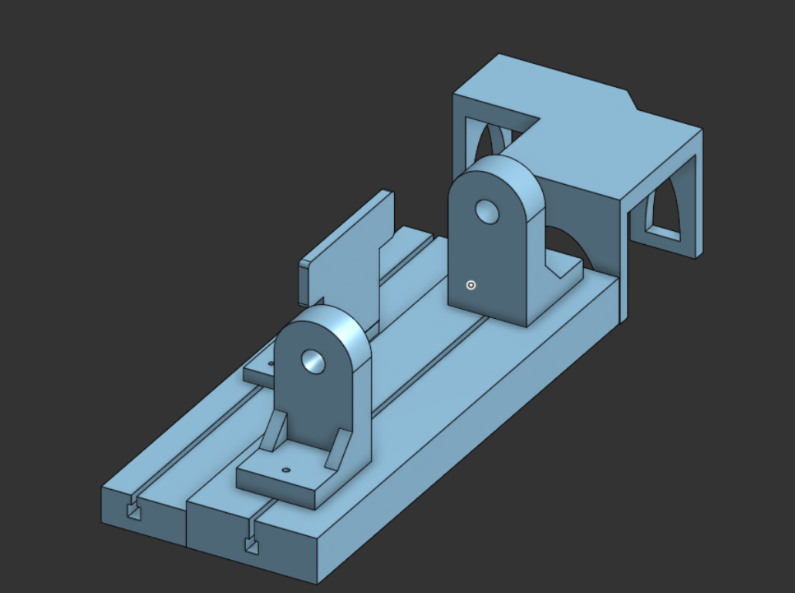
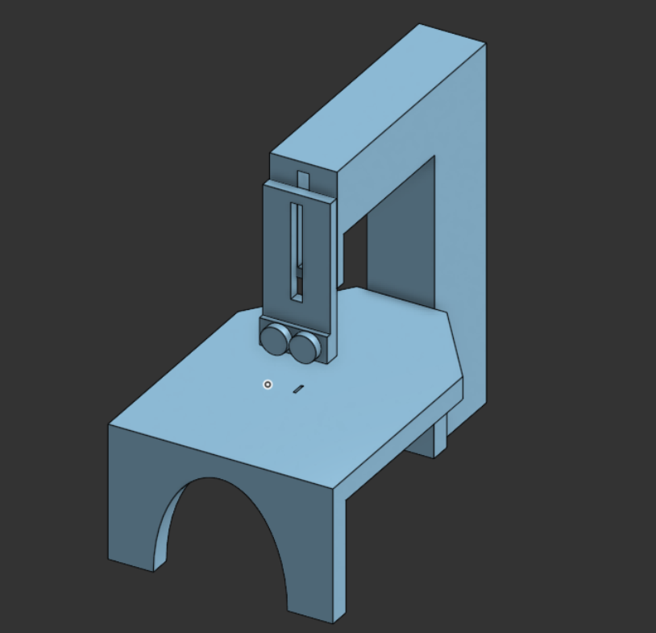
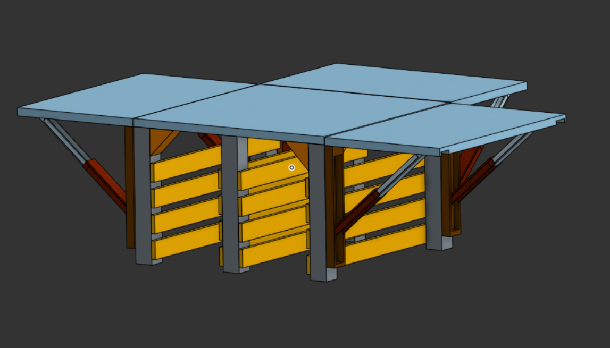
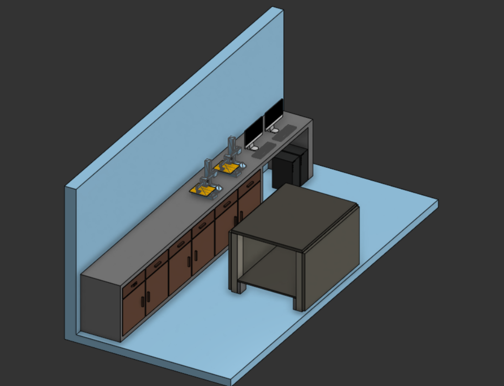

## RedBrickHacks Hardware Track

At the 2026 RedBrickHacks Hackathon hosted by Ashoka University, my four-person team competed in the Hardware Track and placed third.

## Makerspace on Wheels

Inspired by the idea of Science on Wheels, Makerspace on Wheels brings hands-on making to government-school students. Our concept is a mobile workshop stocked with a worktable, handheld tools, and low-cost adapters that let common tools perform tasks that would otherwise require expensive, dedicated equipment.

The van would travel to schools across the country, giving students the chance to learn by building, experimenting, and using practical tools.

## Adapter Concepts

::: {.columns}
::: {.column}
<figure>

<figcaption>Hand-drill-to-lathe adapter concept.</figcaption>
</figure>
:::

::: {.column}
<figure>

<figcaption>Jigsaw-to-scroll-saw adapter concept.</figcaption>
</figure>
:::
:::

## Workshop Bench

<figure>

<figcaption>Worktable and workshop setup concept.</figcaption>
</figure>

## Van Interior

<figure>

<figcaption>Proposed interior layout for the mobile makerspace.</figcaption>
</figure>

## Project Repository

[View the Ashoka Makeathon project on GitHub](https://github.com/AB52-zfy/Ashoka-Makeathon-).