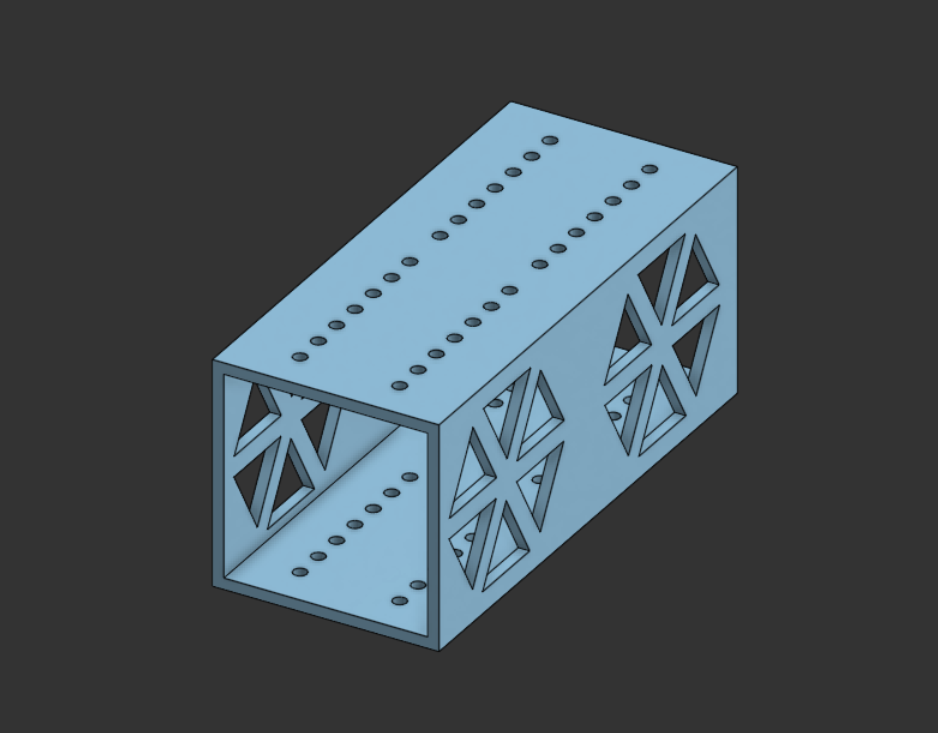
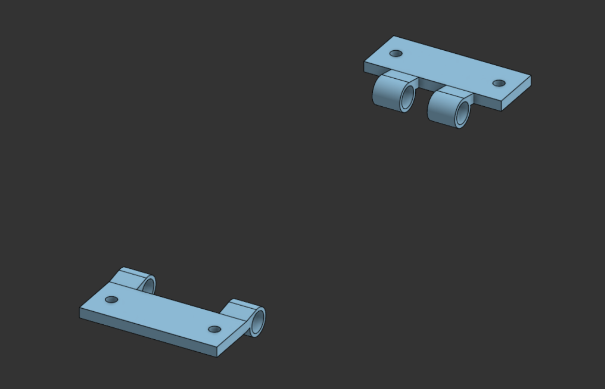
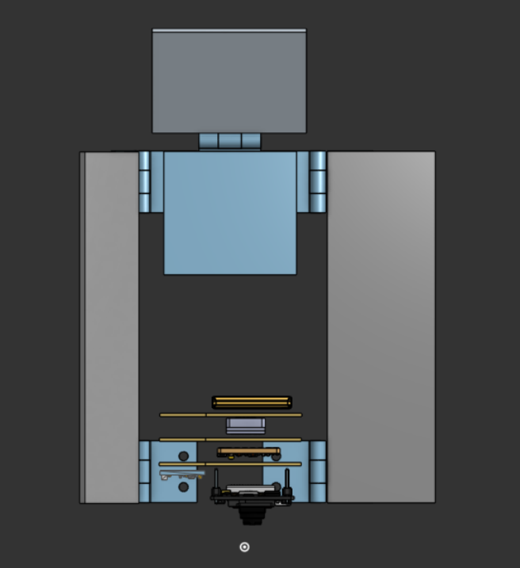
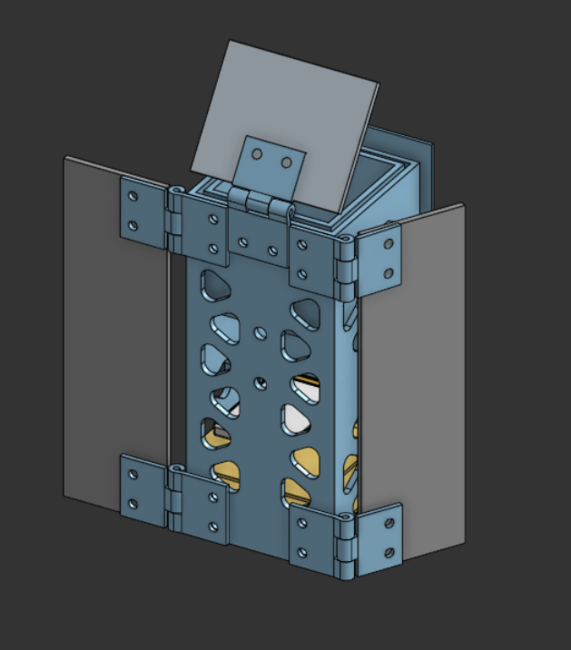

## Project Overview

CanSat is an international aerospace engineering competition in which student teams design, build, and test a miniature satellite (CanSat) that simulates the functions of a real satellite within the dimensions of a soft-drink can.

The 2027 mission involves deploying a 2P PocketQube from the CanSat at 90% of its peak altitude, followed by autonomous descent at a target velocity of \(10 \pm 3\) m/s. The PocketQube must power up upon release, deploy two solar panels after a 5-second delay, and demonstrate successful deployment through onboard sensing and telemetry.

## About the Work Done from the Perspective of the Mechanical Subsystems Team

I was tasked with designing the PocketQube itself- the internal and external componenets along with the PocketQube's parachute, solar panel and boom deployment mechanism while the rest of the mechanical team was involved with designing the boom and container contents. 

::: {.columns}
::: {.column}

**Figure 1:** This was the first prototype which was 3D printed using PLA just to get an idea of the scale of the PocketQube.
:::

::: {.column}

**Figure 2:** This shows the hinge mechanism for the PocketQube's solar panels.
:::
:::

::: {.columns}
::: {.column}

**Figure 3:** This images showcases the rough idea for the placement of the electronics, solar panels and parachute.
:::

::: {.column}

**Figure 4** PocketQube external design with a backplate that would slide onto a rail in the container.
:::
:::

Further work will be updated here as the project progresses.

