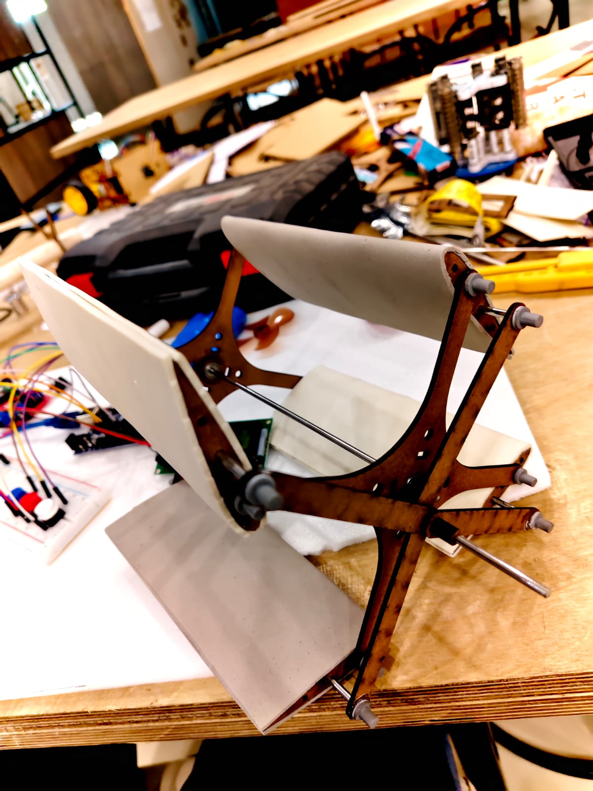
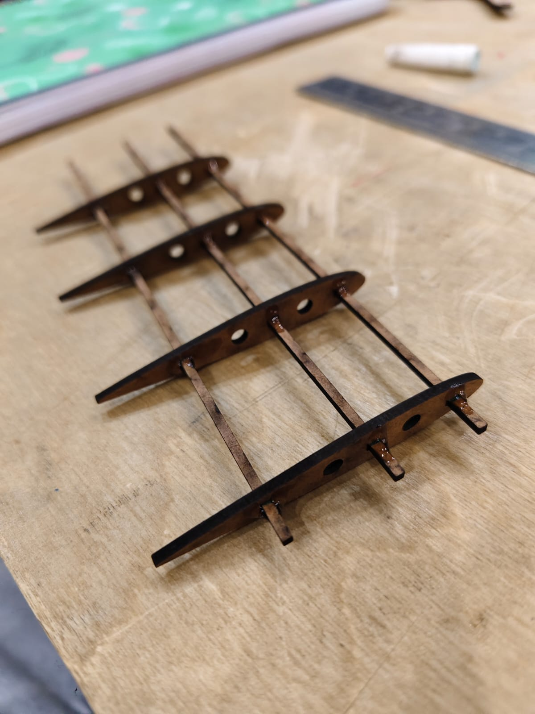
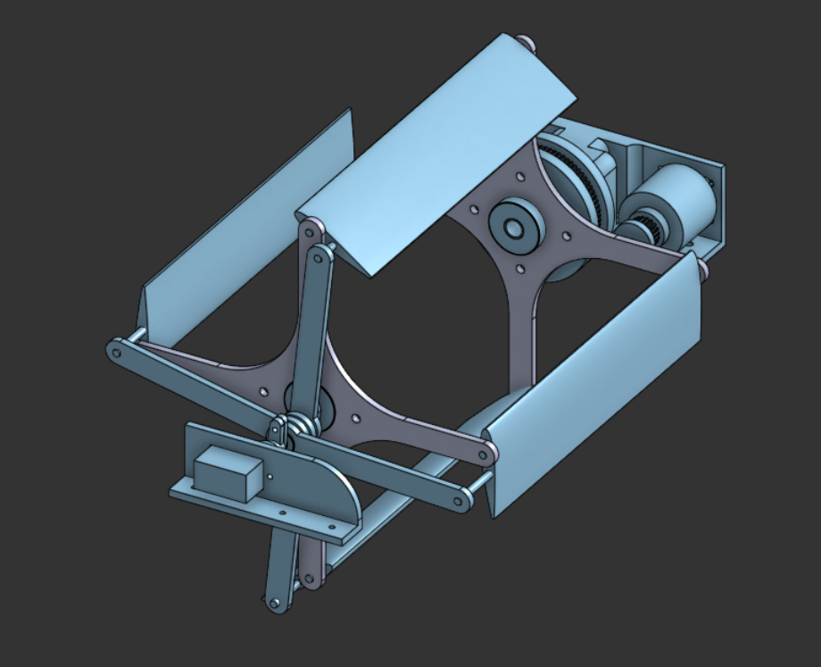
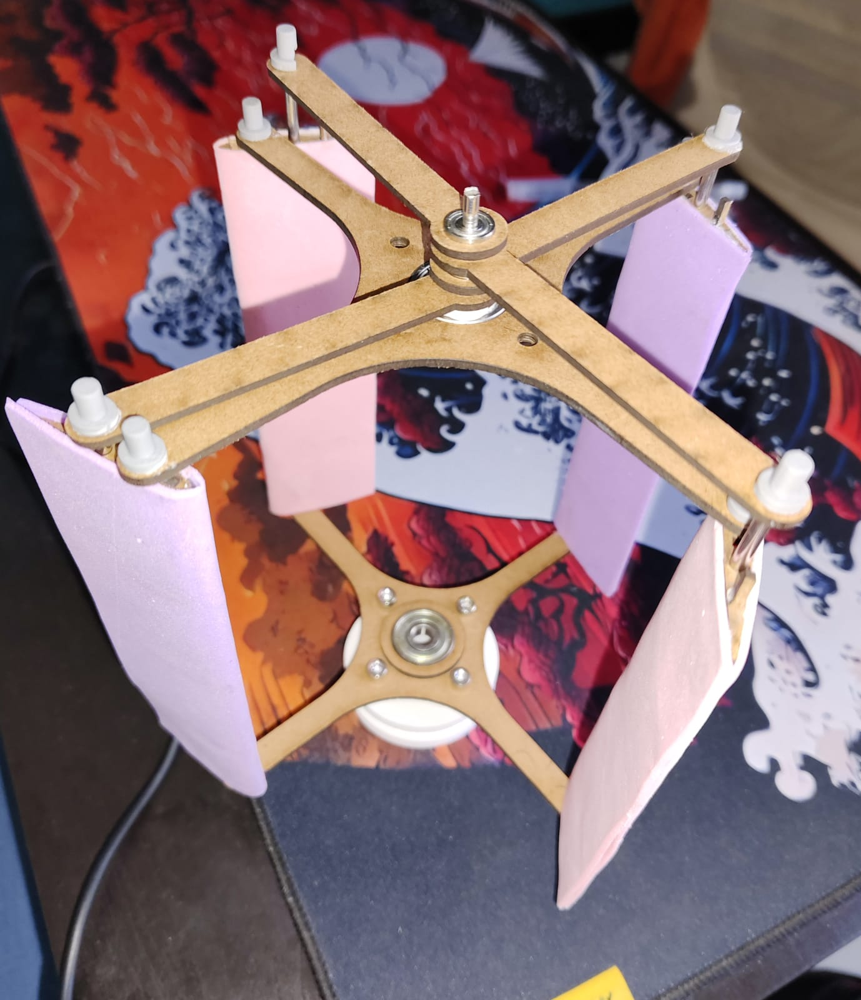

## Internship Overview

During my first-year summer, I worked in Plaksha University's Makerspace on two projects. I spent a few days building a variable voltage power supply using a 220 V-to-30 V transformer and a buck converter. Most of my internship, about 95%, went toward designing and building a motorized cyclorotor.

## Cyclorotor Project

A cyclorotor is a rotor whose blades revolve around a central axis while changing their pitch during each rotation. This lets the rotor generate and redirect thrust, making it possible to control the direction of the force without turning the whole assembly. My project involved designing and building a working cyclorotor assembly.

<figure>

<figcaption>Prototype 1: the first physical cyclorotor prototype.</figcaption>
</figure>

<figure>

<figcaption>Airfoil rib structure used in the rotor assembly.</figcaption>
</figure>

<figure>

<figcaption>CAD model of the cyclorotor assembly.</figcaption>
</figure>

<figure>

<figcaption>Prototype 2: a later physical iteration of the cyclorotor.</figcaption>
</figure>

## What I Learned

This was my first substantial mechanical design project, and it taught me how much work remains between a computer model and a reliable physical assembly. I encountered unwanted friction in joints, challenges fitting and assembling components, and the need to think carefully about clearances and fastening methods. My initial fastening designs were not as refined as they needed to be, but working through those issues gave me valuable practical experience in mechanical design, prototyping, and iteration.