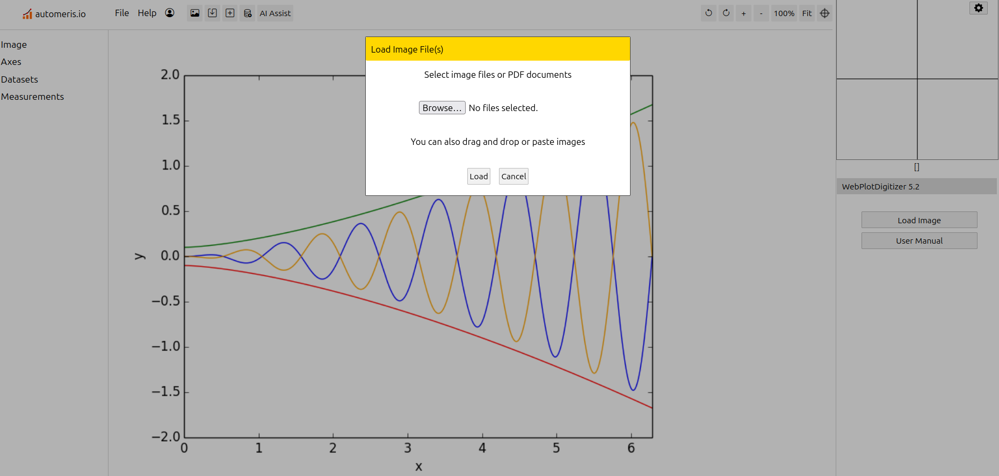
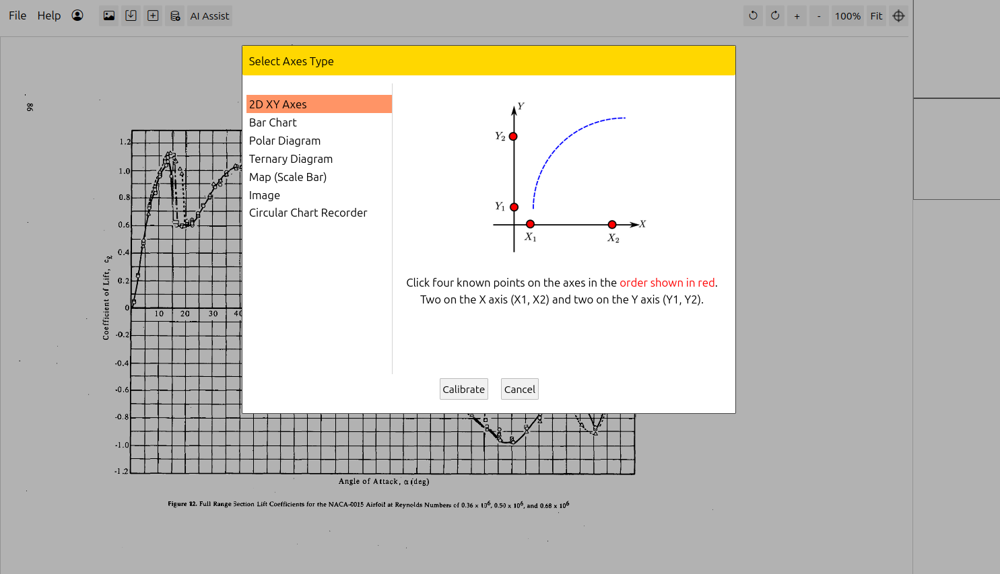
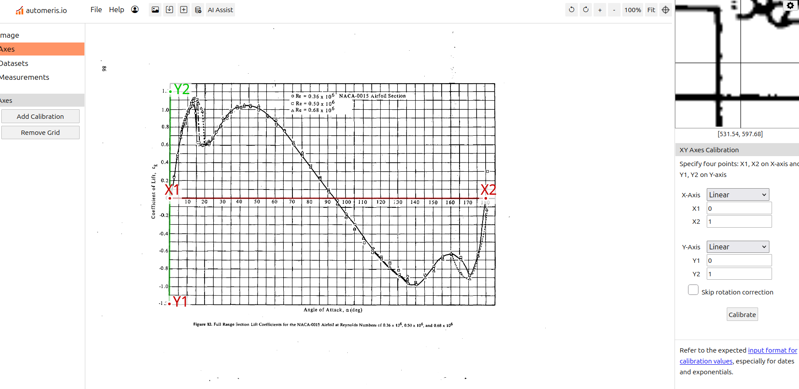
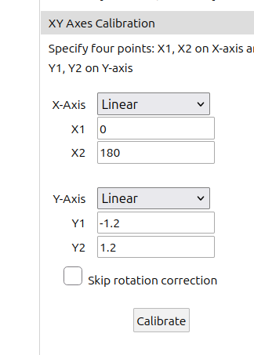
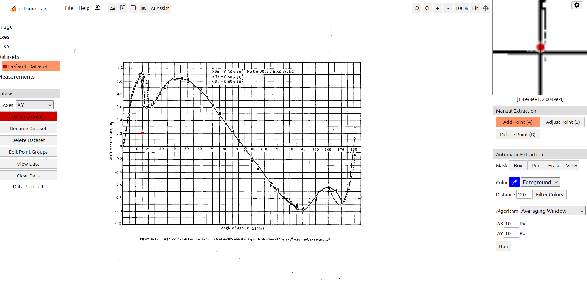
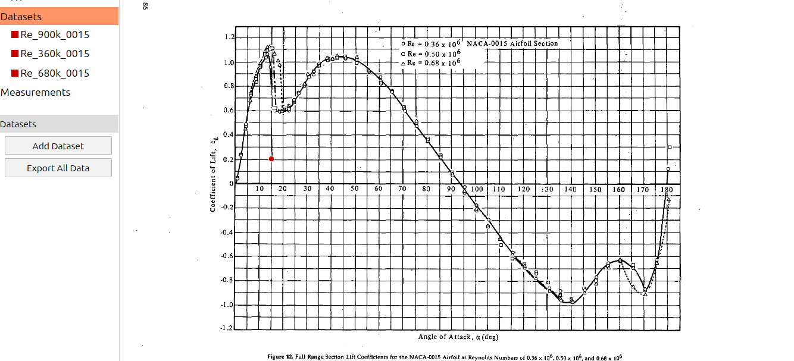
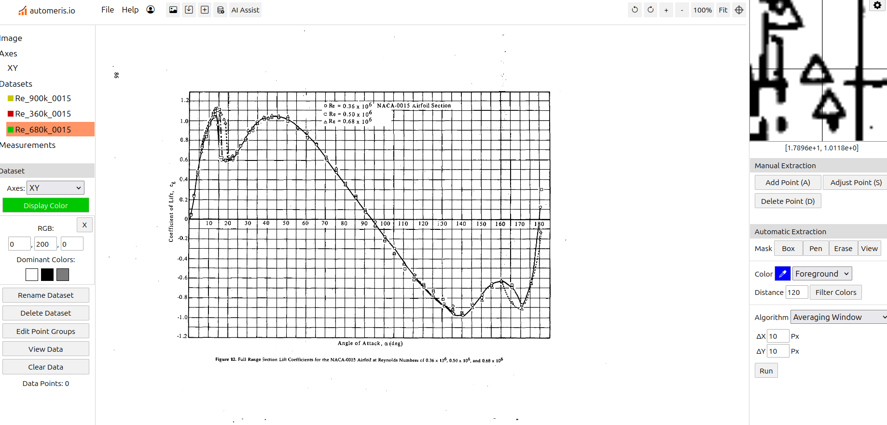

## Internship Overview

Will add later

## The Sheldahl and Klimas Dataset

Sheldahl and Klimas (1981) report wind-tunnel measurements of symmetric NACA airfoils across angles of attack and Reynolds numbers. The digitized collection includes lift, drag, moment, and axial-force coefficients, along with lift-drag polars and increasing/decreasing angle-of-attack sweeps.

## Digitization Process

I loaded the scanned plots into WebPlotDigitizer and selected a 2D XY plot. I calibrated the axes by marking four known reference points and entering their values; for example, the NACA 0015 full-range lift plot uses an angle-of-attack range of 0 to 180 degrees and a lift-coefficient range of -1.2 to 1.2.

I then extracted each curve using manual point selection or color-based automatic extraction, checked the traced points against the plotted curves, and exported the results as CSV files. The included MATLAB scripts organize and plot the digitized series for comparison.

### Process Screenshots

::: {.digitization-steps}

:::

## Data Index

- [Browse the synthesized data](../../assets/files/sheldahl-airfoil-data/Airfoil_Data_Updated/Synthesized_Data/index.html) for interactive plots organized by airfoil and Reynolds number.
- [Browse the experimental data](../../assets/files/sheldahl-airfoil-data/Airfoil_Data_Updated/Experimental_Data/index.html) for all digitized CSV files, full-range workbooks, and SVG plots.

## CFD Simulations for the Cyclorotor Autogyro

After completing the airfoil-data work, I moved on to CFD simulations of a flat plate for my [Cyclorotor Autogyro project](../../projects/ilgc-cyclorotor-autogyro/). The project explores whether a cyclorotor could provide lift for an autogyro aircraft, with a physical prototype as the longer-term goal.

I would also like to credit Professor Shashikant for his help with the CFD simulations. He is also a mentor for my passion project.

The project log notes that flat plates can be a more suitable starting point than symmetrical airfoils at low Reynolds numbers. I began with flat-plate simulations to study the airflow and build a foundation for the project's later design and physical experiments.

Here is the link to the CFD simulation work- how I started off and how I did it: [here](../../projects/ilgc-cyclorotor-autogyro/Document.pdf#page=11).
