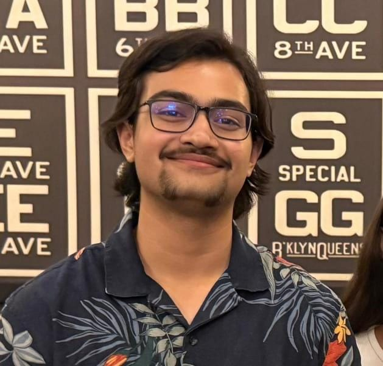

::: {.profile-hero}

::: {.profile-welcome}
And welcome to my website. This is a record of the work I have devoted many hours and careful thought to, from projects to coursework.
:::

### A little bit about myself

::: {.profile-bio}
I am a third-year Robotics and Autonomous Systems major at Plaksha University in Mohali, India. I am especially interested in the mechanical side of robotics and flight, particularly autogyros, which are the focus of my [passion project](/projects/ilgc-cyclorotor-autogyro/). Through my coursework, I have also developed an appreciation for simulating [dynamical systems](/coursework/dynamics-and-simulation/) by numerically solving differential equations. I am keen to pursue this interest as I continue learning about robotics and flight. Outside academics, I play cricket for the university team and enjoy story-driven video games.
:::

::: {.profile-links}
[CV](Apurv_CV.pdf) · [LinkedIn](https://www.linkedin.com/in/apurv-bhushan-244b76317/) · [GitHub](https://github.com/AB52-zfy)
:::
:::

## Experience

::: {.topic-list}
- **CANSAT 2026-27** 
  As part of the Mechanical Subsystems team in Team Kalki, we were tasked with designing a 2P PocketQube Satellite and the container it will deploy from. 
  Click [here](/experience/cansat-2026-27/) for more info.
- **Intern Under [Professor Andy Ruina](http://ruina.tam.cornell.edu/) and Professor Shashikant** 
  Got the opportunity to work under [Professor Andy Ruina](http://ruina.tam.cornell.edu/) on Airfoil Aerodynamics and CFD simulations. 
  Click [here](/experience/robotics-lab-internship/) for more info.
- **Ashoka Makeathon 2026** 
  As part of a 4-member team, we participated and placed 3rd in the Hardware Track in the RedBrickHacks Hackathon hosted by Ashoka University 2026. 
  Click [here](/experience/ashoka-makeathon-2026/) for more info.
- **Plaksha Makerspace Internship** 
  Got the opportunity to work in my University's Makerspace during my first-year summer. Worked on building a variable voltage power supply and a motorized cyclorotor. 
  Click [here](/experience/makerspace-internship/) for more info.
:::

## Projects

::: {.topic-list}
- **ILGC Project: Cyclorotor Autogyro** 
  As part of a multi-semester project-based learning course, ILGC (Innovation Lab & Grand Challenge), I am working on my passion project, the Cyclorotor Autogyro. The project explores using a fixed-pitch cyclorotor as the main lift-generating rotor on an autogyro aircraft. 
  Click [here](/projects/ilgc-cyclorotor-autogyro/) for more info.
- **Optimization Course Project** 
  As part of my 3rd semester Optimization course, my team was tasked with building an optimizer and testing it against other existing optimizers. 
  Click [here](/projects/optimization-course-project/) for more info.
:::

## Coursework

::: {.topic-list}
- **Dynamics and Simulation** 
  Master's level course on solving DEs of dynamical systems using various methods. Offered by [Professor Andy Ruina](http://ruina.tam.cornell.edu/) during my 3rd year (August 2026- December 2026). 
  Click [here](/coursework/dynamics-and-simulation/) for more info.
- **Robot Motion Simulation and Optimization** 
  Course on solving DEs numerically, but more focused on optimization problems. Offered by [Professor Andy Ruina](http://ruina.tam.cornell.edu/) during my 2nd year (January 2026- May 2026). 
  Click [here](/coursework/robot-motion-simulation-and-optimization/) for more info.
:::

::: {.side-quest-callout}
## Side Quests: Click [here](/fun/) to see some fun stuff!
:::
