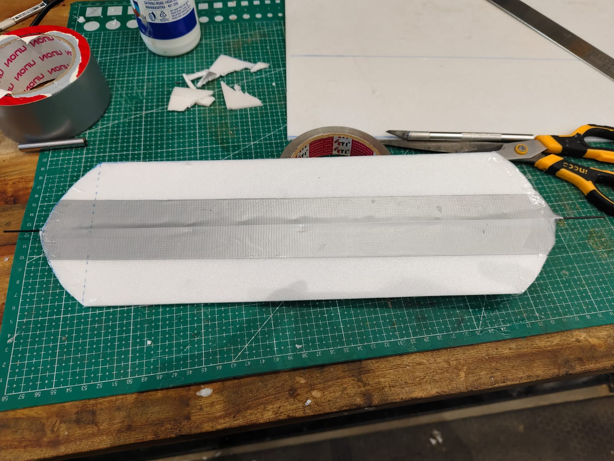
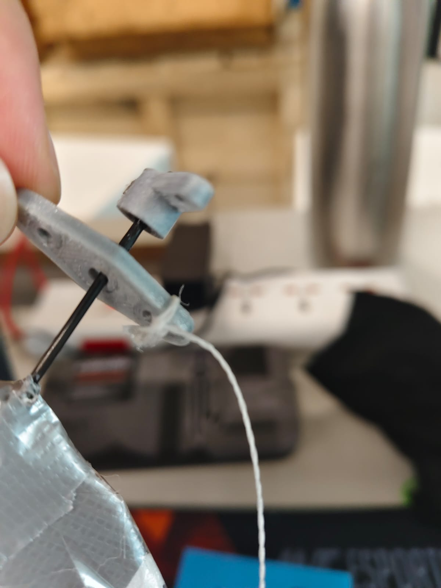
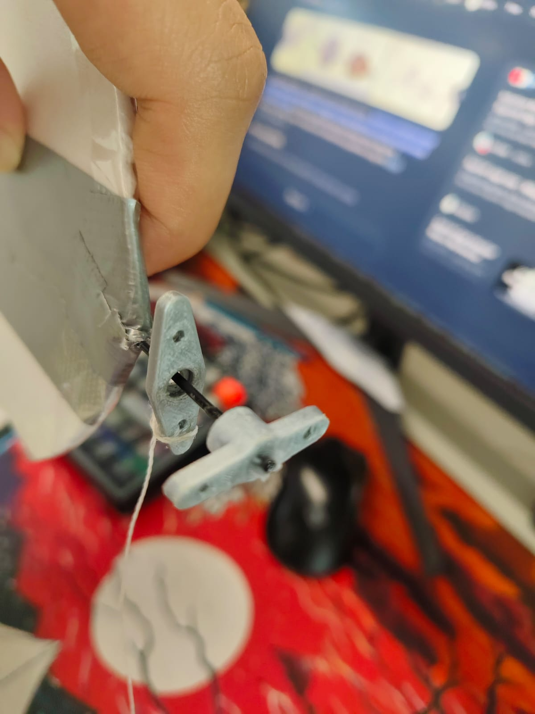

## Project Overview and Research Basis

As part of ILGC (Innovation Lab & Grand Challenge), I am investigating whether a cyclorotor can serve as the lift-generating rotor on an autogyro aircraft. In a cyclorotor, blades rotate around a central axis while changing pitch cyclically; adjusting the pitch offset can redirect the rotor's thrust.

The idea is motivated by the research paper *Energetic Design of a New Autogyro Aircraft with Cyclorotors with Possibility of Energy Harvesting*. It proposes an aircraft with two cylindrical cyclorotor wind turbines mounted on either side of the fuselage, and estimates aerodynamic and vehicle quantities mathematically. As described in my project log, the concept had not yet been demonstrated with a physical aircraft. My aim is to develop a physical cyclorotor-autogyro prototype and investigate the concept through design, simulation, and experiments.

## Project Log

The embedded project log is updated manually as the project develops. Scroll within the document below to read all 42 pages.

<iframe src="Document.pdf" title="Cyclorotor Autogyro project log" width="100%" height="950" style="border: 1px solid #c8cdd2;">
</iframe>

[Open or download the full project log](Document.pdf).

## Photos and Videos

- **Testing the First Rotary Kite: The "Rola-Rola" (also known online as the UFO)**

The first physical experiment in this project was a rotary kite known as the Rola-Rola, or the UFO. I am fascinated by how it flies: two pieces of Depron foam are joined perpendicular to one another, with spars, strings, and threads supporting the structure. In flight, the rectangular horizontal plate rotates around an axis along its length, producing a surprisingly simple but intriguing flying mechanism.

### Kite Components

::: {.columns}
::: {.column}
<figure>

<figcaption>Rotary kite assembly and its suspension threads.</figcaption>
</figure>
:::

::: {.column}
<figure>

<figcaption>Close-up of a spar and string connection.</figcaption>
</figure>
:::

::: {.column}
<figure>

<figcaption>Detail of the kite's thread and rotor linkage.</figcaption>
</figure>
:::
:::

### Second Flight with Takeoff

<video controls preload="metadata" width="100%" aria-label="Rola-Rola rotary kite second flight with takeoff">
	<source src="../../videosandimagesforilgcproject/Second_Flight_with_Takeoff.mp4" type="video/mp4">
	Your browser does not support embedded video. You can <a href="../../videosandimagesforilgcproject/Second_Flight_with_Takeoff.mp4">open the video file</a> instead.
</video>